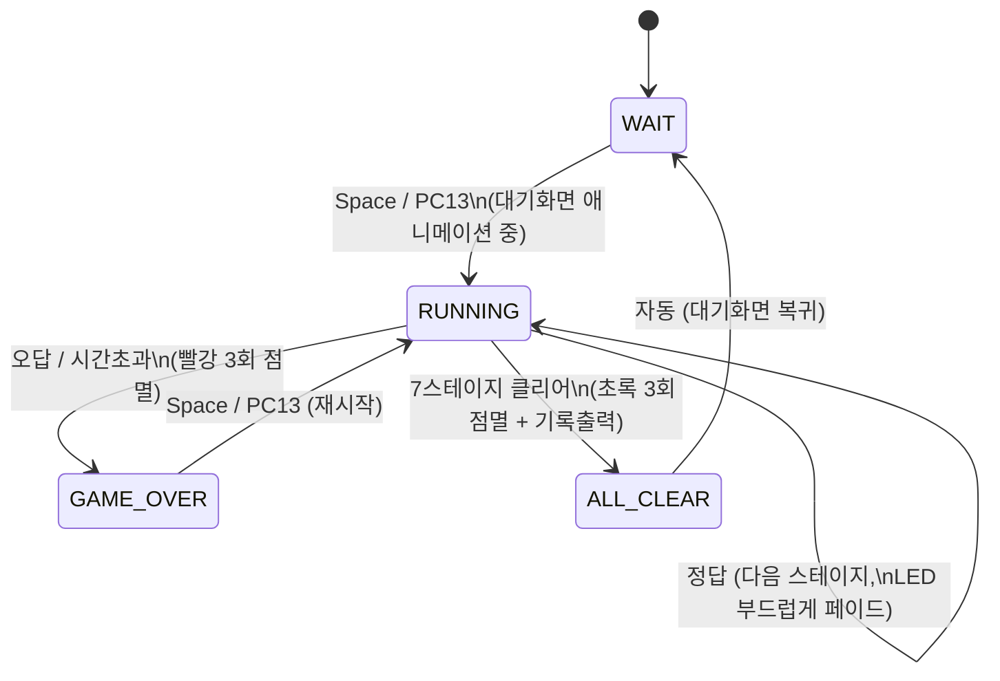
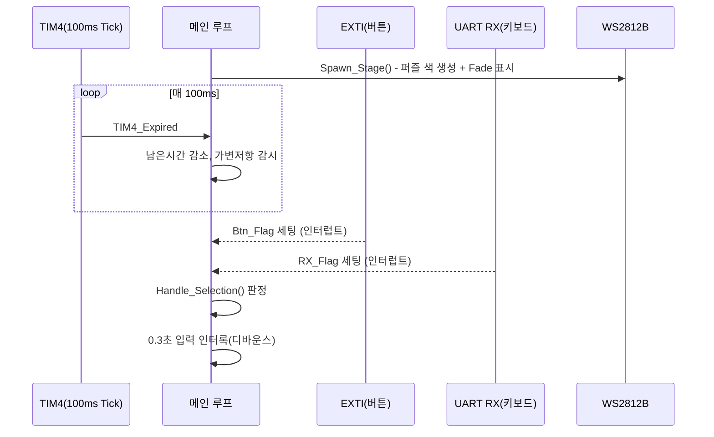

# Odd Color Out — STM32F411 미니 프로젝트 구현 문서

> 작성일: 2026-07-30
> 카테고리: STM
> 원본 노션: [링크](https://app.notion.com/p/Odd-Color-Out-STM32F411-3ad93c81f55e8010a4e4e766d2ff2159)

---

> STM32F411RE(Nucleo-64) 기반, WS2812B / SC16IS752(SPI GPIO 확장) / UART / ADC / 버튼 인터럽트를 활용한 "다른 색 찾기" 게임

---


## 1. 프로젝트 개요


| 항목 | 내용 |
| --- | --- |
| 보드 | NUCLEO-F411RE (STM32F411RE, LQFP64) |
| 클럭 | SYSCLK 96MHz / PCLK1 48MHz |
| 개발 방식 | Bare-metal (레지스터 직접 제어, HAL 미사용) |
| 사용 기술 | GPIO Bit-bang, EXTI Interrupt, Timer Interrupt, UART Interrupt, ADC, SPI, RTC Backup Register |
| 한 줄 소개 | WS2812B RGB LED 4개 중 미세하게 다른 색 1개를 제한시간 안에 찾는 반응속도 게임. 스테이지가 오를수록 색 차이가 줄어들며, 제한시간은 가변저항으로 실시간 조절 가능 |


### 학습/어필 포인트

* 인터럽트 기반 이벤트 처리(EXTI 4채널 + UART RX + Timer)로 폴링 없는 반응형 입력 설계
* SPI로 외부 GPIO 확장 IC(SC16IS752)를 제어해 상태 표시 인터페이스 확장
* 정밀 타이밍이 필요한 프로토콜(WS2812B)을 사이클 단위로 직접 구현
* 비휘발성 저장(RTC 백업 레지스터)을 활용한 기록 보존
* 실기 디버깅을 통해 레지스터 레벨 원인 분석 및 재설계 경험
---


## 2. 게임 규칙

1. 전원 인가 후 4개 WS2812B가 각자 다른 랜덤 색으로 서서히 색이 바뀌는 **대기화면**이 표시됨
1. **Space Bar**(TeraTerm) 또는 **PC13 버튼**으로 게임 시작
1. 매 스테이지, LED 4개 중 3개는 동일한 색, 1개만 RGB 값이 `delta`만큼 다름
1. 버튼(PC0~PC3) 또는 키보드(1~4)로 다른 색 LED를 선택
1. 정답 → SC16IS752 GPIO LED(스테이지 진행 표시) 점등 후 다음 스테이지로, 색 차이(`delta`)가 점점 줄어들며 난이도 상승 (총 7스테이지)
1. 오답/시간초과 → 빨강 점멸 후 게임오버
1. 전 스테이지 클리어 → 초록 점멸 후 소요시간/역대 최고기록 출력, 대기화면으로 복귀
1. 제한시간(5~30초)은 가변저항으로 스테이지 시작 시 결정되며, 게임 도중에도 돌리면 3초간 값이 안정될 때 실시간 반영
---


## 3. 하드웨어 구성


### 3.1 부품 목록


| 부품 | 수량 | 용도 |
| --- | --- | --- |
| NUCLEO-F411RE | 1 | 메인 MCU 보드 |
| SC16IS752 (SPI/I2C ↔ Dual UART, GPIO 겸용) | 1 | 스테이지 진행 LED 7개 구동 (SPI GPIO 확장 용도로 사용) |
| WS2812B (addressable RGB) | 4 | 색상 퍼즐 표시 (1줄 데이지체인) |
| 버튼 | 5 | 색 선택 4개 + 재시작 1개(보드 내장) |
| 가변저항 | 1 | 스테이지 제한시간 설정 |


### 3.2 핀맵


| 신호 | GPIO | 페리퍼럴 | 비고 |
| --- | --- | --- | --- |
| WS2812B DIN | PA0 | GPIO 비트뱅 (DWT 사이클카운터) | 원래 TIM5+DMA 시도 → 실기 미동작으로 전환 (6절 참고) |
| 색선택 버튼 1~4 | PC0 / PC1 / PC2 / PC3 | EXTI0~3, 내부 Pull-up, Falling Edge | 버튼→GND 배선 |
| 재시작 버튼 | PC13 | EXTI15_10 (보드 내장 USER 버튼) | 게임 중엔 무시, WAIT/OVER 상태에서만 동작 |
| 제한시간 가변저항 | PA6 | ADC1_IN6 | 폴링 방식 |
| SC16IS752 SPI | PA8(nCS) / PB3(SCK) / PB4(MISO) / PB5(MOSI) | SPI1 | GPIO 7핀만 사용 (스테이지 표시) |
| TeraTerm UART | PA2(TX) / PA3(RX) | USART2, 115200bps | TX 폴링, RX 인터럽트 |
| 게임 틱 | — | TIM4, 100ms 주기 인터럽트 | 카운트다운/애니메이션/가변저항 감시 기준 |
| 블로킹 딜레이(페이드/점멸) | — | TIM2 | TIM4(게임 틱)와 별도 타이머라 서로 간섭 없음 |
| 베스트기록 저장 | — | RTC 백업레지스터 (BKP0R/BKP1R) | 리셋(NRST) 후에도 유지 |

---


## 4. 소프트웨어 아키텍처


### 4.1 파일 구성


| 파일 | 역할 |
| --- | --- |
| `main.c` | 게임 상태머신, 퍼즐 생성, 입력 처리, 연출 로직 (핵심) |
| `ws2812.c` | WS2812B 비트뱅 드라이버 |
| `key.c` | 버튼 EXTI 초기화 (PC0~3, PC13) |
| `exception.c` | 인터럽트 핸들러 (EXTI, UART RX, TIM4 등) |
| `spi.c` | SC16IS752 SPI 제어 (GPIO 확장) |
| `adc.c` | 가변저항 읽기 |
| `uart.c` | TeraTerm 통신 (printf 리다이렉트 포함) |
| `timer.c` | TIM2/TIM4 등 타이머 유틸리티 |
| `dma.c` | (초기 설계 잔재, 현재 게임에서는 UART TX 등 미사용 경로 포함) |


### 4.2 상태머신




### 4.3 한 스테이지의 이벤트 흐름



---


## 5. 핵심 구현 상세


### 5.1 색상 퍼즐 생성 — 정수 연산 안전설계

밝기 상한(`BRIGHTNESS_MAX`)과 스테이지별 색 차이(`delta`)를 **절대값이 아닌 비율(%)**로 설계했습니다.

```c
static const unsigned char stage_delta_percent[STAGE_MAX] = { 80, 58, 42, 30, 22, 16, 12 };

delta = (BRIGHTNESS_MAX * stage_delta_percent[g_stage - 1]) / 100;
if(delta < 1) delta = 1;
```

절대값으로 관리했을 때 `BRIGHTNESS_MAX`를 낮추면 `delta`가 그보다 커져서 나머지 연산의 분모가 음수가 되고, 부호없는 큰 수로 변환되어 색이 랜덤 폭주하는 버그가 있었습니다(6.2절). 비율 기반으로 바꿔 이 클래스의 버그 자체가 발생할 수 없도록 설계를 변경했습니다.


### 5.2 WS2812B 비트뱅 드라이버

Cortex-M4의 **DWT 사이클카운터**로 나노초 단위 비트 타이밍(T0H 0.4us / T1H 0.85us / 주기 1.25us)을 맞췄습니다.

```c
static void WS2812_Send_Bit(int bit)
{
    unsigned int start = DWT->CYCCNT;
    unsigned int high_cycles = bit ? WS_T1H_CYCLES : WS_T0H_CYCLES;

    GPIOA->BSRR = (1U << 0);
    while((DWT->CYCCNT - start) < high_cycles);
    GPIOA->BSRR = (1U << (0 + 16));
    while((DWT->CYCCNT - start) < WS_PERIOD_CYCLES);
}
```

전송 중에는 `__disable_irq()`로 인터럽트에 의한 타이밍 오차를 차단하고, 프레임 사이 Reset Gap을 300us로 여유있게 잡아 최신 WS2812B 클론칩과의 호환성을 확보했습니다.


### 5.3 입력 인터록(디바운스)

정답/오답 판정 직후 0.3초간(`INPUT_LOCK_TICKS`) 모든 버튼/키 입력을 무시하여, 버튼 채터링이나 연타로 인한 판정 오류(스테이지가 튀거나 게임이 의도치 않게 끝나는 문제)를 해결했습니다.


### 5.4 가변저항 실시간 감시 — 노이즈에 안전한 안정성 카운터

```c
if(abs_int(pot - g_pot_last) >= POT_CHANGE_THRESH)
{
    g_pot_last = pot;
    g_pot_stable_ticks = 0;   // 유의미하게 움직임 -> 리셋
}
else if(g_pot_stable_ticks < POT_STABLE_TICKS)  // 상한 존재
{
    g_pot_stable_ticks++;
    if(g_pot_stable_ticks >= POT_STABLE_TICKS) { /* 이 값에서 딱 한 번만 적용 */ }
}
```

값이 3초(`POT_STABLE_TICKS`) 이상 안정될 때만 실제 제한시간에 반영, ADC 노이즈로 인한 무한 재적용 버그를 안정성 카운터 **상한**으로 해결했습니다(6.4절).


### 5.5 SC16IS752 (SPI GPIO 확장)

SPI1으로 SC16IS752의 GPIO 레지스터(IODIR/IOSTATE)를 직접 제어해 스테이지 진행 LED 7개를 구동합니다. 원래 UART 브리지 IC지만 GPIO 겸용 핀을 활용해 "SPI로 외부 IC의 디지털 출력을 확장 제어"하는 구조를 구현했습니다.


### 5.6 부드러운 LED 연출


| 상황 | 연출 | 구현 |
| --- | --- | --- |
| 스테이지 전환 | 이전 색 → 새 퍼즐 색으로 약 0.4초 페이드 | `LED_Fade_To()`, 선형보간 |
| 대기화면 | 4개 LED가 각자 다른 타이밍에 랜덤색으로 서서히 전환 | `Idle_Animation_Tick()`, 목표값 도달 시 재추첨 |
| 게임오버 | 전체 빨강 0.3초 점멸 ×3 → 오답 당시 색으로 복귀 | `LED_Flash()` |
| 전체클리어 | 전체 초록 0.3초 점멸 ×3 → 대기화면 복귀 | `LED_Flash()` |

페이드/점멸의 블로킹 딜레이는 **TIM2**를 사용했습니다. 게임의 100ms 틱(TIM4)과 같은 타이머를 쓰면 딜레이 함수가 틱 인터럽트 설정(PSC/ARR/CR1)을 덮어써 카운트다운이 깨지기 때문에, 별도 타이머로 분리한 설계입니다.


### 5.7 기록 저장 — RTC 백업 레지스터

```c
Macro_Set_Bit(RCC->APB1ENR, 28);   // PWR Clock On
Macro_Set_Bit(PWR->CR, 8);         // DBP : 백업도메인 쓰기 허용
RTC->BKP1R = (unsigned int)ticks;
RTC->BKP0R = BEST_TIME_MAGIC;      // 유효 매직값으로 "기록 있음" 표시
```

RTC 백업 레지스터(20개 중 2개 사용)는 리셋(NRST) 버튼을 눌러도 유지되는 영역이라, 최고기록을 별도 플래시/EEPROM 없이 간단히 영구 보존할 수 있었습니다. (단, USB를 뽑아 완전히 전원이 끊기면 초기화됨 — 코인셀 미장착 Nucleo 보드 특성)

---


## 6. 트러블슈팅 히스토리

개발 과정에서 실제로 겪은 문제와 원인 분석, 해결 과정입니다.


| # | 증상 | 원인 | 해결 |
| --- | --- | --- | --- |
| 1 | 버튼을 눌러도 반응 없음 | 버튼 배선(GND vs +3.3V)과 코드의 풀업/풀다운·엣지 설정이 반대로 되어있어 전압 변화 자체가 감지 안 됨 | 실제 배선(GND 연결)에 맞춰 내부 Pull-up + Falling Edge로 통일 |
| 2 | `BRIGHTNESS_MAX`를 줄이면 색이 랜덤하게 폭주 | `delta`가 절대값으로 고정돼있어 `BRIGHTNESS_MAX`보다 커지는 경우 나머지 연산의 분모가 음수 → unsigned 변환으로 거대한 수가 되어 색상값 오버플로우 | `delta`를 `BRIGHTNESS_MAX` 대비 비율(%)로 재설계, 항상 안전한 범위 보장 |
| 3 | WS2812B가 완전히 반응 없음 | TIM5 PWM + DMA(CCR 레지스터 DMA 갱신) 방식이 실기에서 동작하지 않음. DMA 트리거 소스(CC1DE→UDE) 등 여러 수정에도 무반응 지속 | 실제 동작이 검증된 GPIO 비트뱅 + DWT 사이클카운터 방식으로 드라이버 전면 교체 (DMA는 다른 용도로 대체 어필 가능) |
| 4 | 가변저항을 돌리지 않아도 계속 "적용됨" 로그가 반복 출력 | 안정성 카운터(`stable_ticks`)에 상한이 없어, 목표치 초과 이후에도 ADC 노이즈(±1~2%)로 매 tick 재적용 조건을 통과 | 안정성 카운터가 임계값에서 더 증가하지 않도록 상한을 걸어 적용이 정확히 한 번만 발생하도록 수정 |
| 5 | 여러 판 진행 시 LED에 잔상/색 섞임처럼 보임 | (a) WS2812B 리셋 갭이 60us로 일부 최신 클론칩 규격(280us+)에 못 미침, (b) 새 게임 시작 시 직전 판의 마지막 색에서부터 부드러운 페이드가 시작되어 의도치 않게 색이 섞여 보임 | 리셋 갭을 300us로 확대, `Restart_Game()` 시 표시 상태를 검정으로 리셋 후 새로 페이드하도록 수정 |
| 6 | (설계 단계에서 사전 방지) LED 페이드/점멸용 블로킹 딜레이가 게임 진행 타이머와 충돌할 뻔함 | `TIM4_Delay()`가 게임의 100ms 틱과 같은 TIM4를 재구성하는 함수라 동시 사용 시 카운트다운이 깨짐 | 딜레이 전용으로 별도 타이머(TIM2)를 사용하도록 설계 단계에서 분리 |

---


## 7. 향후 개선 아이디어

* WS2812B 데이터 라인에 레벨시프터(74HCT125 등) 또는 직렬저항 추가 시 TIM+DMA 방식 재도전 여지 있음(DMA 활용 사례 추가 확보 가능)
* 소요시간 측정을 SysTick 기반으로 전환하면 연출(페이드/점멸) 중 발생하는 최대 1~2초의 오차 없이 더 정밀한 기록 측정 가능
* UART TX를 폴링 대신 DMA로 전환해 로그 출력 중 CPU 점유를 낮추는 것도 가능 (`dma.c`에 이미 준비된 `DMA1_Stream6_USART2_TX_Satrt()` 활용)
---


## 8. 최종 검증

* 전체 소스 `arm-none-eabi-gcc -Wall` 기준 경고 0건으로 컴파일/링크 성공
* 게임 시작~전체클리어~재시작까지 전 상태 전이 정상 동작 확인
